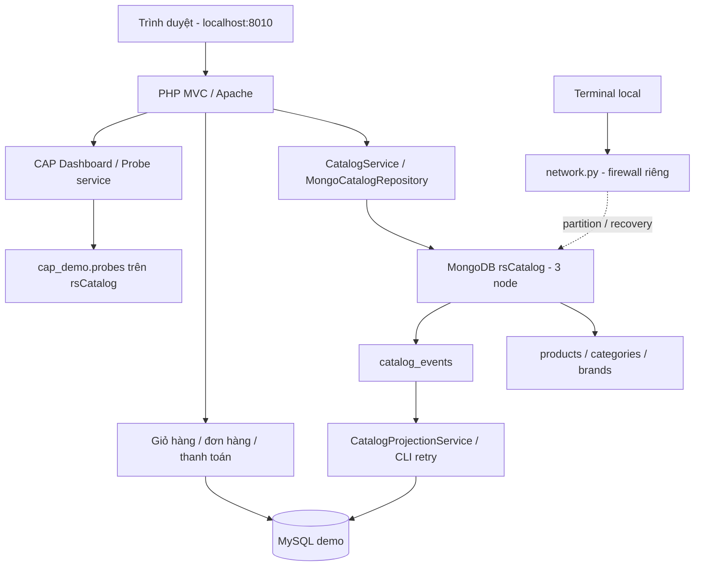
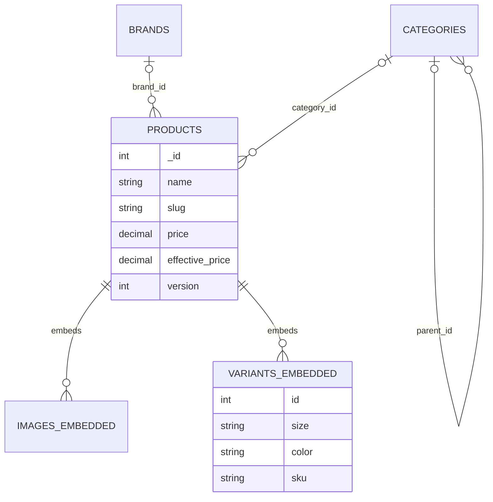

# Thiết kế mô hình dữ liệu NoSQL và kiểm chứng đánh đổi CAP cho hệ thống danh mục sản phẩm

Báo cáo kỹ thuật môn Điện toán đám mây — phiên bản ngày 15/10/2026.

Báo cáo mô tả mã nguồn DTDM và các bằng chứng thực nghiệm đã lưu trong repository. Thông tin trường, lớp, sinh viên và giảng viên được bổ sung khi đưa nội dung vào mẫu nộp của học phần; tài liệu này không giả định các thông tin đó. Phiên bản hiện tại là Markdown, các sơ đồ dùng Mermaid.

## Chương 1. Giới thiệu đề tài

### 1.1. Bối cảnh và bài toán

Danh mục sản phẩm có nhiều thuộc tính liên quan như ảnh, kích cỡ, màu sắc, thương hiệu và danh mục. Trong mô hình quan hệ, một trang chi tiết thường cần kết hợp dữ liệu từ nhiều bảng. Mô hình document cho phép tổ chức một phần dữ liệu được đọc cùng nhau trong cùng bản ghi, nhưng cần cân nhắc giới hạn kích thước, dữ liệu trùng lặp và cách cập nhật.

Khi triển khai cơ sở dữ liệu có bản sao, việc một máy vẫn chạy không đồng nghĩa máy đó còn liên lạc được với các bản sao khác. Hệ thống phải xử lý election, quyền ghi, dữ liệu đọc cũ và trạng thái không chắc chắn của lệnh ghi khi mạng bị chia cắt. Đề tài kết hợp thiết kế dữ liệu với thực nghiệm các tình huống này trên một website có sẵn.

### 1.2. Mục tiêu và phạm vi

| Mục tiêu | Sản phẩm bàn giao |
|---|---|
| Tái sử dụng website hiện có | Website ATELIER với trang khách và quản trị |
| Thiết kế NoSQL cho catalog | Collections, embedded document, reference, validator và index |
| Chuyển dữ liệu an toàn | Backup, migration giữ ID, đối soát trước cutover |
| Kiểm chứng đánh đổi CAP | Replica Set 3 node, partition thật bằng firewall, probe và recovery |
| Truy nguyên kết quả | JSON có operation_id, thời gian, lỗi, node và hash mã nguồn |

Phạm vi chuyển đổi là danh mục sản phẩm. Tồn kho, người dùng, giỏ hàng, đơn hàng, đánh giá và thanh toán tiếp tục dùng MySQL. Đây là kiến trúc kết hợp hai hệ quản trị phục vụ mục tiêu tái sử dụng, không phải chuyển toàn bộ website sang NoSQL.

Thực nghiệm chạy trên Docker local với dữ liệu demo. Ba container MongoDB cùng nằm trên một máy nên không đại diện cho ba vùng sẵn sàng độc lập. Đề tài chưa triển khai cloud nhiều máy, chưa thử thanh toán thật và chưa đo hiệu năng tải lớn.

### 1.3. Phương pháp thực hiện

Quy trình gồm khảo sát source và database; thiết kế document theo truy vấn; backup và migration; tích hợp tầng truy cập dữ liệu; kiểm tra chức năng; tạo partition có kiểm soát; đối soát dữ liệu sau recovery. Kết luận được phân biệt thành hành vi đã quan sát, bảo đảm được tài liệu chính thức mô tả và giới hạn chưa kiểm chứng.

## Chương 2. Cơ sở lý thuyết NoSQL và CAP

### 2.1. Document, embedding và reference

MongoDB lưu dữ liệu dưới dạng BSON document. Embedding phù hợp với dữ liệu phụ thuộc vòng đời và thường được đọc cùng đối tượng cha. Reference phù hợp khi dữ liệu được dùng chung hoặc có khả năng tăng không giới hạn. Schema linh hoạt vẫn cần quy tắc kiểm tra kiểu và miền giá trị; index cần lựa chọn theo truy vấn, đồng thời làm tăng chi phí ghi. [MongoDB Data Modeling](https://www.mongodb.com/docs/manual/data-modeling/best-practices/).

Trong đề tài, ảnh và thông tin mô tả biến thể được nhúng vào sản phẩm. Danh mục và thương hiệu được tham chiếu. Tồn kho không được nhúng vì website tiếp tục xử lý checkout bằng giao dịch SQL. Đây là quyết định theo ranh giới nghiệp vụ hiện có, không phải hạn chế buộc mọi hệ thống MongoDB phải đặt tồn kho ở SQL.

### 2.2. Replica Set

Cấu hình thực nghiệm gồm ba thành viên dữ liệu của `rsCatalog`, mỗi thành viên có một phiếu bầu. Ở trạng thái ổn định có một Primary nhận ghi và hai Secondary sao chép dữ liệu. Phân vùng mạng có thể khiến Primary cũ mất đa số, trong khi hai thành viên còn liên lạc được tiến hành election. Không được coi tên `mongo1` là vai trò Primary cố định.

Replication cung cấp bản sao phục vụ failover nhưng không thay thế backup: thay đổi ngoài ý muốn vẫn có thể được sao chép sang các node khác. Trong đề tài, dữ liệu gốc và volume demo được tách riêng; migration không được dùng để ghi đè cơ sở dữ liệu production.

### 2.3. Nội dung định lý CAP

Trong mô hình của Gilbert và Lynch, consistency được xét theo nghĩa atomic/linearizable, availability yêu cầu thao tác tại node không lỗi hoàn tất theo đặc tả, còn partition cho phép thông điệp giữa các nhóm node không được chuyển tới. Khi phân vùng xảy ra, không thể bảo đảm đồng thời đầy đủ consistency và availability cho đối tượng đọc/ghi trong mô hình này. Một phản hồi lỗi nhanh không có nghĩa thao tác nghiệp vụ vẫn khả dụng. [Gilbert và Lynch, 2002](https://www.comp.nus.edu.sg/~gilbert/pubs/BrewersConjecture-SigAct.pdf).

Bài thực nghiệm hữu hạn minh họa sự đánh đổi; nó không chứng minh lại định lý và không thể xác nhận mọi lịch sử thực thi của MongoDB. Việc một số lệnh đọc vẫn trả dữ liệu không đủ để gọi toàn hệ thống là AP; tương tự, không thể gán nhãn luôn CP mà bỏ qua cấu hình đọc và thời điểm quan sát.

### 2.4. Cấu hình đọc và ghi

| Cấu hình | Vai trò trong bài thử |
|---|---|
| Read preference | Chọn loại node được ưu tiên đọc; replica connection và direct connection cần phân biệt |
| Read concern `local` | Đọc dữ liệu cục bộ; bài thử kiểm tra dữ liệu đó có cũ so với ghi ở phía đa số không |
| Read concern `majority` | Đọc trạng thái đã được đa số xác nhận; không đồng nghĩa luôn đọc phiên bản mới nhất |
| Read concern `linearizable` | Áp dụng trên Primary, với truy vấn một document xác định duy nhất trong bài thử |
| Write concern `1` | Chỉ yêu cầu Primary xác nhận; ghi có thể bị rollback nếu chưa được sao chép trước khi mất vai trò |
| Write concern `majority` | Yêu cầu xác nhận từ đa số theo cấu hình replica set |
| `wtimeout` | Giới hạn chờ xác nhận ghi; timeout không tự chứng minh rằng dữ liệu chưa được ghi |

Kết hợp ghi majority với đọc linearizable trên một document cung cấp bảo đảm thứ tự thời gian thực theo các điều kiện MongoDB mô tả. Bài thử dùng `_id` để xác định document và `maxTimeMS` để giới hạn chờ đọc. [Linearizable read concern](https://www.mongodb.com/docs/manual/reference/read-concern-linearizable/). Lệnh báo write concern timeout có thể đã thay đổi dữ liệu; cần kiểm tra kết quả thay vì suy luận chỉ từ lỗi. [Write concern](https://www.mongodb.com/docs/manual/reference/write-concern/).

## Chương 3. Phân tích và thiết kế hệ thống

### 3.1. Hệ thống được tái sử dụng

Website ATELIER dùng PHP 8.2, Apache, MVC tự xây dựng, giao diện render từ PHP view cùng CSS và JavaScript. PDO phục vụ MySQL; Composer và extension MongoDB 2.5.0 phục vụ catalog. Không xây lại frontend bằng một framework khác.

Các module được giữ gồm đăng nhập/phân quyền, tài khoản, sản phẩm/danh mục, tìm kiếm/lọc, giỏ hàng, checkout, đơn hàng, đánh giá, coupon, styling và quản trị. Truy cập catalog được đưa qua service/repository MongoDB; các module nghiệp vụ khác tiếp tục dùng model SQL phù hợp.

Database gốc có các bảng `users`, `categories`, `products`, `product_images`, `variants`, `carts`, `cart_items`, `orders`, `order_items`, `reviews`, `payments`, `coupons`, `stylings`, `styling_images`. Quan hệ chính là sản phẩm thuộc danh mục, có nhiều ảnh/biến thể; giỏ và dòng đơn liên hệ sản phẩm/biến thể; đơn gắn người dùng và thanh toán. Brand ban đầu là tên trong sản phẩm, được tách thành collection khi migration.

### 3.2. Kiến trúc triển khai



Mũi tên từ event qua bộ đồng bộ thể hiện luồng xử lý, không phải daemon đang chạy liên tục. `scripts/sync-catalog.php` cung cấp retry bằng CLI. Web không được gắn Docker socket; Dashboard không có endpoint thay đổi mạng. Network script chỉ thao tác trên container có label và network của `dtdm_demo`.

Compose demo mở website qua `127.0.0.1:8010`; MongoDB và MySQL không publish cổng ra host. Quyền `NET_ADMIN` chỉ phục vụ firewall trong container MongoDB demo. Stack chưa bật xác thực MongoDB, TLS hoặc cấu hình bảo mật production; không đưa nguyên Compose này lên môi trường công khai.

### 3.3. Mô hình document



Sơ đồ mô tả quan hệ logic; `IMAGES_EMBEDDED` và `VARIANTS_EMBEDDED` là mảng con, không phải collections độc lập. Các reference không phải khóa ngoại do MongoDB tự cưỡng chế.

| Collection | Nội dung và lựa chọn thiết kế |
|---|---|
| `products` | ID số giữ từ SQL; tên/slug/giá/trạng thái; `images` và `variants` nhúng; category_id, brand_id tham chiếu |
| `categories` | Danh mục và parent_id; dùng chung giữa sản phẩm |
| `brands` | ID hash tên thương hiệu sau trim, phân biệt tên theo nội dung chính xác; chưa chuẩn hóa mọi biến thể tên |
| `counters` | Cấp ID để giữ tương thích với URL và dữ liệu SQL |
| `catalog_events` | Snapshot, version và trạng thái đồng bộ sang SQL |
| `cap_demo.probes` | Nằm trong database thực nghiệm riêng, lưu key/value, operation_id và run_id |

Ảnh được lưu bằng đường dẫn; file vẫn ở `public/uploads`. Giá dùng Decimal128, thời gian dùng UTCDateTime. Mỗi sản phẩm tối đa 100 ảnh và 200 biến thể theo validator. Reviews giữ ở SQL vì liên hệ người dùng và có thể tăng không giới hạn. Tên brand được sao chép trong product để phục vụ truy vấn; đổi tên hàng loạt chưa có giao diện chuyên biệt.

Ví dụ dưới đây chỉ minh họa một phần cấu trúc BSON, không phải bản ghi trích từ dữ liệu thật:

```javascript
{
  _id: 101, name: "Áo demo", slug: "ao-demo", category_id: 6,
  brand_id: null, price: Decimal128("250000"), sale_price: null,
  effective_price: Decimal128("250000"), status: "active", version: 1,
  images: [{id: 501, image_url: "/uploads/demo.jpg", is_primary: true, sort_order: 0}],
  variants: [{id: 801, size: "M", color: "Đen", sku: "DEMO-M"}]
}
```

Không có `stock` trong document: MySQL là nguồn ghi tồn kho duy nhất.

### 3.4. Validation và index

`app/services/CatalogSchema.php` cài `$jsonSchema` cho products/categories/brands. Products yêu cầu các trường định danh, nội dung chính, giá, trạng thái, mảng và version; kiểm tra giá không âm, kiểu Decimal128, status active/hidden và giới hạn mảng. Biểu thức bổ sung kiểm tra ID biến thể và cặp size/color không trùng trong một sản phẩm, đồng thời effective_price bằng sale_price nếu có, ngược lại bằng price.

| Index đã cài | Mục đích |
|---|---|
| products/categories: slug unique | Tránh trùng đường dẫn định danh |
| products: status, category_id, effective_price | Hỗ trợ nhóm truy vấn trạng thái/danh mục/giá |
| products: status, created_at giảm dần, _id giảm dần | Hỗ trợ danh sách theo thời gian |
| products: variants.id unique | Giữ ID biến thể duy nhất giữa các document |
| products: variants.size; variants.color | Hỗ trợ lọc biến thể |
| categories: parent_id | Truy vấn phân cấp |
| catalog_events: applied, created_at | Tìm sự kiện chờ đồng bộ |

Validator bổ sung vẫn cần để phát hiện trùng ID bên trong một mảng. `counters` và `catalog_events` hiện không có JSON Schema riêng. Tìm kiếm dùng regex đã escape, có giới hạn đầu vào/thời gian; không khẳng định index hiện tại tối ưu mọi truy vấn substring. Chưa có số liệu `explain` hoặc benchmark chứng minh cải thiện tốc độ so với SQL.

### 3.5. Ranh giới giao dịch và đồng bộ

Mỗi sửa catalog ghi document và event trong một transaction MongoDB với write concern majority. Bộ đồng bộ dùng transaction SQL và bảng `catalog_projection_versions` để replay theo version. Các bảng SQL catalog là bản sao tương thích phục vụ khóa ngoại và nghiệp vụ còn lại.

Không có atomic commit xuyên MongoDB và MySQL. Nếu MongoDB commit rồi SQL lỗi, event còn chờ. Checkout kiểm tra version SQL bằng version catalog đã đọc; khi lệch, sản phẩm chưa thể mua qua phiên bản đó. Checkout khóa hàng version, giảm tồn có điều kiện và tạo đơn trong giao dịch SQL. Giá đơn là snapshot tại request, không phải cam kết linearizable xuyên hai database.

Sửa mô tả biến thể không ghi đè stock. Thay đổi tồn trên form được chuyển thành delta so với lúc mở form, áp dụng một lần để tránh mất giao dịch bán đồng thời; đây không phải kiểm kê tuyệt đối. Sản phẩm bị xóa theo hướng ẩn/đánh dấu, giữ lịch sử đơn và ID biến thể. Chưa có HTTP idempotency key cho mọi thao tác catalog, nên timeout cần đối soát trước khi người dùng tạo lại.

### 3.6. Kế hoạch chuyển dữ liệu và phục hồi

Migration đọc snapshot SQL nhất quán, nhóm ảnh/biến thể theo sản phẩm, chuyển kiểu dữ liệu và giữ ID. Quy trình là dry-run → backup → migration → verify → đồng bộ → bật driver MongoDB. Script dừng khi đích khác nội dung nguồn thay vì ghi đè. Verify toàn bộ nội dung chuẩn hóa chỉ phù hợp trước cutover; không dùng nguồn SQL cũ để ghi đè catalog đã chỉnh sửa sau cutover.

Backup demo gồm SQL dump, file upload, commit và SHA256SUMS; restore được thử vào database tạm mới. Không xóa database gốc hoặc volume cũ. Backup SQL này không thay thế một chiến lược backup MongoDB sau cutover; sao lưu/khôi phục catalog MongoDB độc lập là phần cần bổ sung trước triển khai thật. Quy trình chi tiết nằm ở [local-demo.md](../nosql/local-demo.md).

## Chương 4. Triển khai và thực nghiệm

### 4.1. Môi trường và bằng chứng

Lần chạy CAP hoàn chỉnh dùng MongoDB 8.0.32, ba node có vote=1, priority=1, electionTimeoutMillis=10000 và writeConcernMajorityJournalDefault=true. Cấu hình được lưu trong [bằng chứng môi trường](../cap/evidence/matrix-20261015T051721Z-b25cec-environment.json). Compose dùng tag `mongo:8.0`, nên phiên bản patch khi build lại có thể khác.

Bộ probe ghi thời gian bắt đầu/kết thúc, elapsed_ms, target, server thực tế nếu lấy được, read/write concern, operation_id và lỗi. `elapsed_ms` đo trong PHP, không gồm chi phí khởi chạy Docker/PHP CLI. Read maxTimeMS và write wtimeout là 2000 ms; server selection là 2000 ms, socket timeout là 5000 ms. Driver retry tắt; runner có thể gửi lệnh mới để chờ Primary sẵn sàng và lưu từng operation_id.

### 4.2. Kiểm thử chuyển đổi và chức năng

Các kết quả dưới đây được ghi nhận ở nhiệm vụ triển khai trước, không phải chạy lại trong nhiệm vụ viết báo cáo. Nguồn: [baseline-results.md](../nosql/baseline-results.md).

| Kiểm tra | Kết quả đã ghi nhận |
|---|---|
| Backup và restore vào DB thử | Khớp 13 products, 6 categories, 46 variants, 28 product_images, 5 users, 36 orders, 41 order_items, 6 payments |
| Migration và verify | 13 products, 6 categories, 2 brands; nội dung chuẩn hóa khớp, chạy lại thành công |
| Catalog integration | 14 kiểm tra qua: CRUD, regex, bảo toàn biến thể/kho, replay, version và các tình huống nghiệp vụ |
| Checkout cạnh tranh | Hai process mua cùng một đơn vị tồn: một thành công, một thiếu kho; tồn còn 0 |
| HTTP smoke | Trang khách, tìm kiếm/lọc, admin, chi tiết và kiểm tra CSRF qua |
| Dashboard smoke | Quyền truy cập, CSRF, probe bình thường, log/export và guard demo qua |

Ở baseline cũ có trang tìm kiếm HTTP 200 nhưng body chứa PHP fatal; lỗi placeholder SQL đã được sửa. Điều này cho thấy HTTP 200 riêng lẻ chưa đủ xác nhận website đúng. Các kiểm tra chức năng không phải stress benchmark hoặc chứng minh mọi race condition đã được loại bỏ.

### 4.3. Kịch bản 1 — Normal Operation

Runner `tests/cap-matrix.py` chỉ chạy khi cụm khỏe và không có partition. Nó ghi baseline với majority vào key riêng của run, rồi đọc trên cả ba node cho đến khi operation_id khớp. Trong lần chạy hoàn chỉnh, mongo3 là Primary; ghi baseline mất 3,522 ms và các đọc kiểm tra bản sao đều thành công.

### 4.4. Kịch bản 2 — Network Partition

Script cài chain `DTDM_CAP`, DROP cả hai chiều giữa Primary hiện tại với hai node còn lại, không dừng mongod. Kiểm tra TCP xác nhận bốn hướng qua biên partition timeout, hai hướng giữa cặp đa số vẫn thông. Web observer vẫn kết nối trực tiếp được cả ba node.

Trong lần ma trận hoàn chỉnh, mongo3 bị cô lập và mongo1 lên Primary. Kết nối direct cố định node giúp kiểm tra từng phía; kết nối replica có thể chọn node ở cả hai phía vì web không bị cô lập. Không được mô tả đây là mọi client thật đều bị giới hạn mạng tương ứng.

Một bài kiểm thử mạng riêng trước đó quan sát election/stepdown sau 11,331 giây, với mongo1 bị cô lập và mongo2 lên Primary. Con số đó thuộc [lần network-validation](../cap/network-validation.md), không phải độ trễ election đo trong lần ma trận này và không phải hằng số của MongoDB.

### 4.5. Kịch bản 3 — Consistency và Availability

Lần hoàn chỉnh diễn ra ngày 15/10/2026 từ 12:17:21 đến 12:17:50 giờ Việt Nam. Các hàng dưới trích từ [JSON gốc](../cap/evidence/matrix-20261015T051721Z-b25cec.json).

| Thời điểm / phía | Thao tác | Kết quả thực tế | ms |
|---|---|---|---:|
| Vừa cô lập mongo3 | Ghi w:1 | Được xác nhận | 1,836 |
| Vừa cô lập mongo3 | Ghi majority | Lỗi 64, chờ replication timeout | 2016,524 |
| Sau election, mongo3 | Ghi w:1 / majority | Cả hai lỗi not primary | 1,352 / 1,407 |
| Sau election, mongo3 | secondaryPreferred + local | Đọc thành công, dữ liệu cũ | 2,777 |
| Sau election, mongo3 | secondaryPreferred + majority | Đọc thành công, dữ liệu cũ | 4,334 |
| Sau election, mongo3 | primary + linearizable | Lỗi non-primary | 2,528 |
| Phía đa số, mongo1 | Ghi majority | Được xác nhận | 3,975 |
| Phía đa số, mongo1 | primary + linearizable | Đọc thành công, dữ liệu mới | 15,211 |
| Replica connection | secondary + majority | Chọn mongo3, đọc dữ liệu cũ | 3,150 |

“Cũ” nghĩa là operation_id của baseline, trong khi update-shared đã hoàn tất bằng majority trước khi bắt đầu đọc. “Mới” nghĩa là khớp update-shared. Không suy ra stale chỉ từ đồng hồ hoặc cảm nhận giao diện.

Tổng cộng có 43 probe: 22 trước recovery và 21 lượt đối soát sau recovery. Bốn thao tác báo lỗi thuộc các tình huống kiểm tra; runner vẫn PASS vì kết quả phù hợp và đối soát hoàn tất. Bảng đầy đủ cùng kết quả các preference khác nằm trong [matrix-results.md](../cap/matrix-results.md). Một mẫu không đủ tính p95/p99 hoặc kết luận preference nào luôn nhanh hơn.

### 4.6. Kịch bản 4 — Recovery

Recovery gỡ chain riêng, chờ trạng thái khỏe và đọc majority từng key trên từng node. Có bảy key được đối soát, kết quả operation_id hoặc không tồn tại khớp giữa cả ba node. Những ghi majority đã được xác nhận và không bị ghi đè vẫn tồn tại. Baseline bị update-shared thay thế có chủ đích, không phải mất dữ liệu.

Ghi w:1 được xác nhận trong cửa sổ trước stepdown không còn tồn tại sau recovery; log mongo3 ghi nhận rollback. Phía cô lập không có quyền tiếp tục nhận ghi khi đã xuống Secondary. Do đó w:1 không biến hệ thống thành multi-primary.

Catalog trước/sau khớp số lượng và SHA256: 13 sản phẩm, 6 danh mục, 2 thương hiệu. Firewall được phục hồi; ID, thời điểm khởi động và số lần restart container không đổi. Cluster kết thúc lần chạy với mongo1 Primary và hai node còn lại Secondary; vai trò về sau có thể thay đổi.

### 4.7. Lần chạy chưa hoàn tất và tính minh bạch

[Lần đầu](../cap/evidence/matrix-20261015T051633Z-e52a6a.json) gặp write concern timeout trên Primary mới, nhưng sau recovery operation_id của lệnh đó có trên cả ba node. Runner cũ chỉ công nhận bản ghi bị thay thế khi lệnh sau báo thành công, nên báo nhầm mất baseline đã được majority xác nhận.

Runner được sửa để xác định ghi đè qua operation_id thực tế và chờ ghi majority thành công trước phần ma trận ổn định. JSON lần lỗi được giữ nguyên, nhưng trường kết luận lỗi của runner không được dùng làm bằng chứng MongoDB mất ghi majority. Kết quả này cũng minh họa vì sao phải đối soát lệnh timeout thay vì mặc định thất bại hoàn toàn.

## Chương 5. Đánh giá, kết luận và hướng phát triển

### 5.1. Mức độ đáp ứng

| Yêu cầu | Đánh giá |
|---|---|
| Website hoạt động, tái sử dụng source | Đã tích hợp vào website PHP hiện có, có kiểm tra chức năng |
| Mô hình NoSQL | Có embedded/reference, kiểu BSON, validation và index trong mã nguồn |
| Chuyển dữ liệu an toàn | Có backup, restore thử, migration giữ ID và verify trước cutover |
| Replica Set và partition thật | Có 3 node, firewall hai chiều và recovery đã kiểm tra |
| Thí nghiệm CAP | Có một ma trận đại diện hoàn chỉnh, một lần chưa hoàn tất được công khai |
| Dashboard | Có trạng thái, probe, thời gian, log/export và hướng dẫn terminal |
| Báo cáo | Có 5 chương và liên kết bằng chứng; chưa xuất bản nộp theo mẫu trường |

### 5.2. Kết luận từ phạm vi đã thử

Kết quả cho thấy phía đa số tiếp tục nhận ghi sau election, trong khi phía thiểu số mất quyền ghi và không thực hiện được linearizable read khi đã xuống Secondary. Một số đọc vẫn thành công ở phía cô lập nhưng trả giá trị cũ. Ghi w:1 có thể được xác nhận trong cửa sổ chuyển tiếp rồi rollback khi hội nhập lại.

Đánh đổi phải được mô tả theo thao tác, concern, định tuyến và thời điểm. Không có cơ sở từ bài thử để kết luận MongoDB luôn CP hoặc luôn AP. Việc dùng đa số không đồng nghĩa mọi đọc là linearizable, và việc website trả HTTP thành công không thay thế kiểm tra đúng dữ liệu.

SePay và các chức năng thanh toán hiện là phần nghiệp vụ SQL được tái sử dụng. Chúng không phải đối tượng ghi thử CAP trong đồ án này; không có kết luận về khả năng chịu partition của dịch vụ SePay từ các probe MongoDB.

### 5.3. Hạn chế và rủi ro còn lại

Dataset nhỏ, chỉ có một lần ma trận hoàn chỉnh, không có phân phối độ trễ hoặc kiểm thử tải. Ba node cùng host không chống được lỗi toàn máy. Chưa thử crash/restart, partition bất đối xứng, causal session hoặc sharding. Probe chỉ quan sát một số lịch sử trên document, không phải bộ kiểm chứng linearizability tổng quát.

Catalog và SQL chưa có atomic commit xuyên hệ; retry đồng bộ chưa có daemon; thao tác HTTP chưa có idempotency key toàn diện. Ràng buộc tham chiếu category/product giữa nhiều admin vẫn có race cần xử lý thêm. Regex substring chưa tối ưu cho dữ liệu lớn. Backup MongoDB, xác thực, TLS, phân quyền vận hành và quản lý secrets cần hoàn thiện trước triển khai production.

### 5.4. Hướng phát triển

Ưu tiên bổ sung retry worker có giám sát cho catalog_events, idempotency ở ranh giới HTTP và kiểm thử lỗi commit/đồng bộ. Tiếp theo là sao lưu/khôi phục MongoDB độc lập, đo query plan với dataset lớn và chuẩn hóa thương hiệu/tìm kiếm. Thực nghiệm mở rộng cần lặp nhiều lần, ghi rõ môi trường, thêm client bị giới hạn mạng thật và triển khai trên nhiều máy để phân biệt partition với lỗi chung của host.

Các bước này là hướng phát triển, không được tính là đã triển khai hoặc đã kiểm thử trong báo cáo hiện tại.

## Phụ lục. Truy nguyên mã nguồn và tài liệu

| Nội dung | Nguồn trong repository |
|---|---|
| Stack demo | [docker-compose.demo.yml](../../docker-compose.demo.yml) |
| Schema và index | [CatalogSchema.php](../../app/services/CatalogSchema.php) |
| Snapshot migration | [CatalogSnapshot.php](../../app/services/CatalogSnapshot.php) |
| Đồng bộ hai database | [catalog-design.md](../nosql/catalog-design.md) |
| Probe và log | [CapExperimentService.php](../../app/services/CapExperimentService.php) |
| Điều khiển partition | [network.py](../../scripts/cap/network.py) |
| Runner ma trận | [cap-matrix.py](../../tests/cap-matrix.py) |
| Cài đặt và khởi động | [setup.md](../setup.md) |
| Kết quả chi tiết | [matrix-results.md](../cap/matrix-results.md) |

Tài liệu lý thuyết được dẫn trực tiếp tại Chương 2. Tất cả số liệu thực nghiệm trong Chương 4 lấy từ tài liệu baseline hoặc JSON có liên kết; không bổ sung số liệu giả để lấp các phần chưa chạy.
