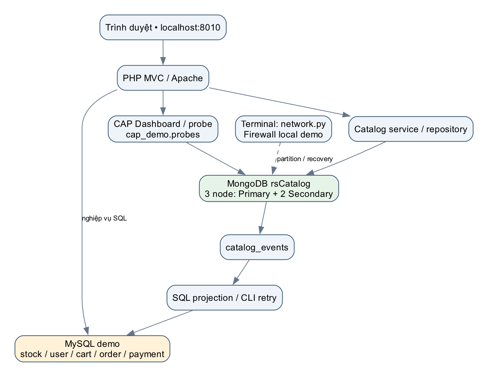
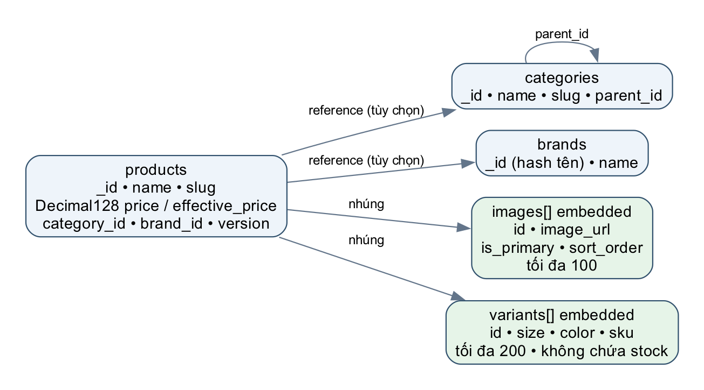

# NoSQL Product Catalog & CAP

Thiết kế mô hình dữ liệu NoSQL và kiểm chứng đánh đổi CAP

Website ATELIER • MongoDB Replica Set • Docker local

Thông tin sinh viên/lớp/giảng viên: bổ sung theo hồ sơ học phần.

---

# 1. Bài toán và mục tiêu

- Tái sử dụng website PHP MVC có sẵn.
- Chuyển catalog sang MongoDB, giữ nghiệp vụ SQL phù hợp.
- Tạo partition thật, quan sát đọc/ghi và recovery.
- Kết luận từ operation_id và log, không chỉ từ trạng thái HTTP.

---

# 2. Kiến trúc kết hợp

- PHP 8.2 / Apache, giao diện PHP + CSS + JavaScript.
- MongoDB: catalog, category, brand, event đồng bộ.
- MySQL: stock, user, cart, order, payment, review.
- CAP Dashboard dùng database probe riêng, không có Docker socket.

---

# 3. Thiết kế document

- Products nhúng images và variants: tối đa 100 ảnh, 200 biến thể.
- Category/brand dùng reference; stock chỉ ở MySQL.
- Giữ ID cũ, Decimal128 cho giá, UTCDateTime cho thời gian.
- Validator và index được khai báo trong CatalogSchema.php.

---

# 4. Migration và đồng bộ

- Dry-run → backup → migrate → verify → cutover.
- Đã chuyển 13 products, 6 categories, 2 brands.
- Catalog + event trong transaction MongoDB; projection theo version ở SQL.
- Checkout kiểm tra phiên bản; không có atomic commit xuyên hai DB.

---

# 5. CAP: cần phân biệt

- Consistency ở đây là linearizability, khác consistency của ACID.
- Lỗi nhanh không có nghĩa thao tác nghiệp vụ vẫn khả dụng.
- Majority read không tự bảo đảm dữ liệu mới nhất.
- Phải chỉ rõ concern, định tuyến và thời điểm; không gán nhãn luôn CP/AP.

Nguồn lý thuyết: Gilbert–Lynch (2002); tài liệu read/write concern MongoDB, dẫn trong báo cáo.

---

# 6. Thiết lập thực nghiệm

- MongoDB 8.0.32, rsCatalog có 3 node, mỗi node 1 vote.
- iptables DROP hai chiều; không stop/restart container.
- Web observer nhìn được cả hai phía; direct probe cố định node.
- 4 giai đoạn: normal → partition → đọc/ghi → recovery.

---

# 7. Demo trực tiếp

1. Xác nhận baseline có trên cả 3 node.
2. Cô lập Primary hiện tại, quan sát election.
3. Ghi majority ở Primary mới, lưu ID sau.
4. Đọc ở node cô lập và so sánh ID trước/ID sau.
5. Recovery, đọc lại cả 3 node, tải log.

Lệnh chi tiết và phương án sự cố: demo-guide.md.

---

# 8. Kết quả đã chạy ngày 15/10/2026

| Tình huống | Kết quả |
|---|---|
| Vừa cô lập, ghi w:1 | OK, sau đó rollback |
| Vừa cô lập, ghi majority | Timeout khoảng 2016,524 ms |
| Node cô lập sau stepdown | Ghi bị từ chối |
| Node cô lập, đọc local/majority | OK nhưng stale |
| Primary mới, linearizable read | OK và latest |

Một lần hoàn chỉnh: 43 probe, gồm 21 lượt đối soát sau recovery. Đây không phải benchmark.

---

# 9. Recovery và minh bạch bằng chứng

- Đối soát 7 key trên cả 3 node.
- Ghi majority được xác nhận, không bị ghi đè: còn tồn tại.
- Ghi w:1 ở Primary cũ: không còn; log MongoDB có rollback.
- Catalog/hash và tiến trình không đổi, firewall phục hồi.
- Giữ cả lần chạy đầu bị lỗi assertion; không trình bày nó là PASS.

---

# 10. Giới hạn và hướng phát triển

- Ba node cùng host; chưa cloud nhiều máy hay stress benchmark.
- Chưa kiểm chứng mọi lịch sử/tổ hợp concern.
- Cần worker retry, idempotency HTTP và backup MongoDB.
- Cần auth/TLS và quản lý vận hành trước production.
- SePay không thuộc probe CAP và chưa thử giao dịch thật.

---

# 11. Kết luận

- Website được tái sử dụng, catalog đã có mô hình NoSQL.
- Partition thật cho thấy khác biệt giữa đọc được, đọc mới và ghi được xác nhận.
- Timeout cần đối soát; w:1 có thể rollback.
- Kết luận luôn gắn với cấu hình và bằng chứng thực tế.

Báo cáo, JSON gốc và hướng dẫn demo có trong repository DTDM.
